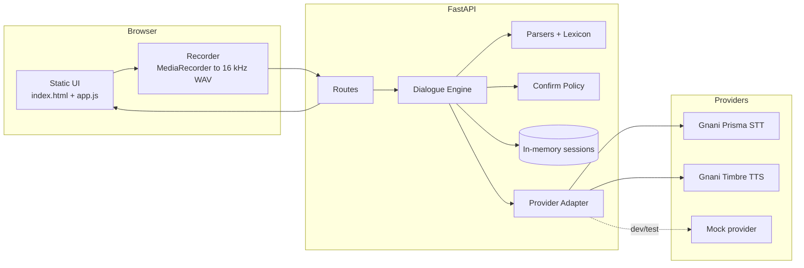
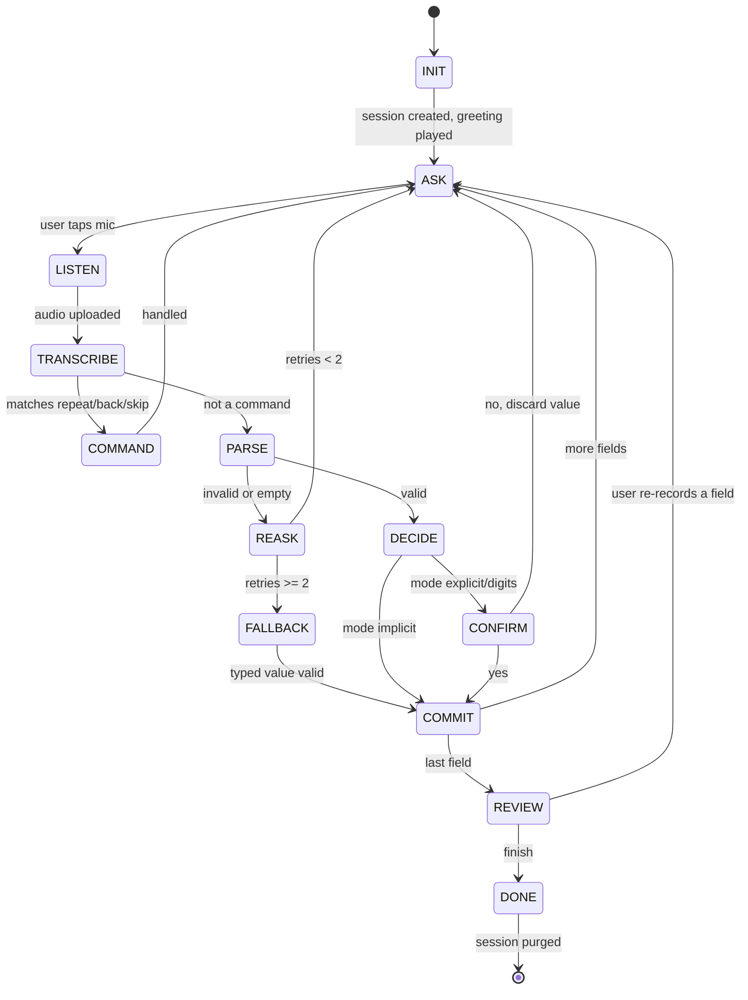
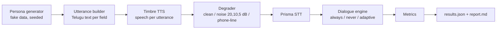

# Bolo Form: Architecture and Workflow

Companion to PRD.md and DESIGN.md.

## 1. Overview

A small FastAPI service plus a no-build static frontend. All Gnani calls go through one **provider adapter**, so the app and tests run on a **mock provider** with no network. The dialogue logic is plain Python and fully testable without audio.



## 2. Repo structure

```
bolo-form/
├── AGENT.md  PRD.md  DESIGN.md  ARCHITECTURE.md  README.md
├── .env.example            # GNANI_API_KEY=, PROVIDER=mock|gnani
├── pyproject.toml  Makefile
├── app/
│   ├── main.py             # app factory, static mount, health
│   ├── config.py           # pydantic-settings
│   ├── api/                # routes_sessions.py routes_forms.py routes_eval.py
│   ├── core/
│   │   ├── dialogue.py     # state machine
│   │   ├── parsers.py      # per-type parsing
│   │   ├── validators.py
│   │   ├── lexicon_te.py   # Telugu number words, yes/no, commands, aliases
│   │   ├── confirm_policy.py
│   │   ├── noise_estimate.py
│   │   └── session_store.py
│   ├── providers/          # base.py gnani.py mock.py factory.py
│   ├── audio/              # wav.py degrade.py
│   ├── forms/              # farmer_scheme.yaml pension_scheme.yaml health_camp.yaml
│   └── web/                # index.html app.js recorder.js styles.css eval.html limits.html logo.svg
├── eval/                   # personas.py run_eval.py metrics.py report.py results/
├── tests/
└── docs/gnani_api_notes.md # pasted from docs.gnani.ai, source of truth for the adapter
```

## 3. Provider adapter (the only place Gnani is touched)

```python
# app/providers/base.py
from dataclasses import dataclass
from typing import Protocol

@dataclass
class STTResult:
    text: str
    confidence: float | None   # None if the API does not return it
    language: str
    raw: dict                  # keep for debugging, never log transcripts by default

@dataclass
class TTSResult:
    audio: bytes
    mime: str                  # e.g. "audio/wav"

class Provider(Protocol):
    def transcribe(self, wav_bytes: bytes, lang: str = "te") -> STTResult: ...
    def synthesize(self, text: str, lang: str = "te", voice: str | None = None) -> TTSResult: ...
```

- `GnaniProvider` implements this using **only** what `docs/gnani_api_notes.md` says. Until that file is filled in, it raises `NotConfiguredError`. **Never guess endpoints, headers, or field names.**
- `MockProvider`: STT looks up a deterministic transcript from a hash of the audio or a test hint; TTS returns a short generated tone WAV. Supports fault injection (drop a digit, swap a number) for tests and for the demo of caught errors.
- Both providers wrap calls with a timeout, 2 retries with backoff, and a credit counter (increment per call, logged to stdout).
- TTS responses are cached on disk by `(text, lang, voice)` hash. Static prompts are pre-generated once to save credits and latency.

## 4. Data model

```python
Field(key, type, prompt_te, prompt_en, risk: "low"|"medium"|"critical",
      validation: {min, max, digits, regex}, choices: [{value, label_te, label_en, aliases[]}])

Session(id, form_id, lang, telephony_sim: bool, created_at, last_seen,
        idx: int, fields: dict[key, FieldState], state: State, retries: int,
        pending: Pending | None)

FieldState(value, status: "empty"|"confirmed"|"implicit"|"edited"|"skipped"|"needs_check",
           source: "voice"|"typed", transcript: str|None, confidence: float|None, attempts: int)

Pending(field_key, parsed_value, display_text, readback_text, confirm_mode)
```

Sample form config:

```yaml
id: farmer_scheme
title_te: రైతు సహాయ పథకం (డెమో)
title_en: Demo Farmer Support Scheme
fields:
  - key: name        # type text, risk medium
  - key: age         # integer 18..100, risk medium
  - key: village     # text, risk medium
  - key: district    # choice, aliases for Telugu and English spellings, risk medium
  - key: phone       # phone, exactly 10 digits, risk critical
  - key: land_acres  # decimal 0.1..500, risk critical
  - key: crop        # choice [paddy, chilli, cotton, groundnut, other], risk low
  - key: has_bank    # yes_no, risk low
```

Districts: use the current Andhra Pradesh district list and verify it against an official source before shipping, because names have changed over time.

## 5. Dialogue state machine



**Command recognition** (checked before parsing, using normalized text):
- repeat: మళ్ళీ చెప్పండి, మళ్ళీ, repeat, again
- back: వెనక్కి, back
- skip: దాటవేయి, skip
- yes: అవును, ఔను, సరే, సరైనదే, yes, haan
- no: కాదు, లేదు, తప్పు, no

Keep these lists in `lexicon_te.py` and verify the Telugu with a native speaker. Whole-word match only, so a name that contains "no" is not read as a command.

## 6. Risk-adaptive confirmation policy (D1)

Goal: ask fewer confirmations without increasing silent errors.

```python
def decide_confirm_mode(field, parsed, stt, audio_stats, attempts) -> str:
    # Hard rules first
    if field.risk == "critical":
        return "digits" if field.type == "phone" else "explicit"

    score = 0.0
    score += {"low": 0.0, "medium": 0.3}[field.risk]
    score += (1 - stt.confidence) * 0.4 if stt.confidence is not None else 0.2   # unknown = mild penalty
    score += 0.2 if audio_stats.snr_db < 15 else 0.0                              # noisy
    score += 0.2 if parsed.ambiguous else 0.0                                     # e.g. fuzzy match runner-up close
    score += 0.15 * attempts                                                      # struggled before

    if score >= T_HIGH: return "explicit"      # Telugu read-back + yes/no
    if score >= T_LOW:  return "simple"        # read-back, auto-accept on no objection? (no: still yes/no)
    return "implicit"                          # commit, show on screen, undo for 5 s, re-read in review
```

- **Modes:** `digits` (grouped read-back with pauses), `explicit` (read-back + yes/no), `simple` (short read-back + yes/no), `implicit` (commit with undo; always shown on the review screen).
- **Noise estimate (`noise_estimate.py`):** frame the PCM (20 ms), compute RMS per frame, take roughly the 10th percentile as the noise floor and the 90th as speech level, `snr_db = 20*log10(speech/noise_floor)`. It is crude; label it "estimated" and do not over-claim.
- **Tuning:** choose `T_LOW` and `T_HIGH` on the **dev** persona split only. Report on the **test** split. Never tune on the test split.
- **Baselines compared in the eval:** `always_confirm`, `never_confirm`, `adaptive`.

## 7. Parsers (`parsers.py`, `lexicon_te.py`)

| Type | Rules |
|---|---|
| `integer` | Accept digits (Telugu and Latin), Telugu number words, mixed ("ఇరవై ఐదు", "25", "twenty five"). Range check. |
| `decimal` | As integer, plus "రెండున్నర" (2.5), "అర" (0.5), "పావు" (0.25), "point"/"పాయింట్" style. |
| `phone` | Strip spaces, hyphens, "+91"/"91" prefix, convert Telugu digits and digit words, handle "double"/"triple" patterns (such as "డబుల్ నైన్"), require exactly 10 digits, first digit 6–9. |
| `choice` | Normalize, exact alias match, then fuzzy (token-set ratio, threshold about 85). If top two matches are close, mark `ambiguous=True`. |
| `yes_no` | From lexicon; unknown -> re-ask. |
| `text` | Trim, collapse whitespace, strip filler words ("నా పేరు", "my name is"), non-empty, max length. |

Number word starter table (**verify with a native speaker**, and handle compounds and variants like ఒకటి/ఒక్కటి):
0 సున్నా, 1 ఒకటి, 2 రెండు, 3 మూడు, 4 నాలుగు, 5 ఐదు, 6 ఆరు, 7 ఏడు, 8 ఎనిమిది, 9 తొమ్మిది, 10 పది, 20 ఇరవై, 30 ముప్పై, 40 నలభై, 50 యాభై, 60 అరవై, 70 డెబ్బై, 80 ఎనభై, 90 తొంభై, 100 వంద, 1000 వెయ్యి.

Unit tests must cover each type with at least 10 real-looking inputs, including wrong ones.

## 8. API

| Method | Path | Purpose |
|---|---|---|
| GET | `/health` | Liveness + provider name |
| GET | `/api/forms` | List form configs |
| POST | `/api/sessions` | Body `{form_id, lang, telephony_sim}` -> `{session_id, prompt}` |
| POST | `/api/sessions/{id}/turn` | Multipart `audio` (WAV) **or** JSON `{text}` -> turn result |
| PATCH | `/api/sessions/{id}/fields/{key}` | Manual edit `{value}` |
| GET | `/api/sessions/{id}` | Current state (no audio, no raw transcripts unless debug) |
| POST | `/api/sessions/{id}/finish` | Mark done, returns summary |
| DELETE | `/api/sessions/{id}` | Purge now |
| GET | `/api/tts?text=&lang=` | Cached TTS for static strings (rate limited) |
| GET | `/api/eval/latest` | Latest `results.json` |

Turn result:

```json
{
  "heard": "ఇరవై ఐదు",
  "parsed": {"value": 25, "display": "25"},
  "action": "confirm | commit | reask | command | review | done | fallback",
  "confirm_mode": "digits | explicit | simple | implicit | null",
  "prompt": {"text_te": "...", "text_en": "...", "audio_b64": "...", "mime": "audio/wav"},
  "progress": {"index": 2, "total": 8},
  "form": {"name": {"value": "...", "status": "confirmed"}},
  "debug": {"stt_ms": 0, "tts_ms": 0, "snr_db": 0, "confidence": null}
}
```

`debug` is returned only when `DEBUG=1`.

## 9. Audio pipeline

1. **Browser:** `getUserMedia({audio:{echoCancellation:true, noiseSuppression:true, channelCount:1}})`. Use `MediaRecorder` or an AudioWorklet to capture PCM; resample to **16 kHz mono 16-bit WAV** in the browser (OfflineAudioContext) so no server ffmpeg is needed. Check the actual required format in `docs/gnani_api_notes.md`.
2. **Phone-line mode (FR-14):** `audio/degrade.py::telephony()` resamples to 8 kHz, band-passes 300–3400 Hz, applies µ-law compand/expand, resamples back. Applied server-side before STT so it works for typed-in test WAVs too.
3. **Server:** validate size (for example under 2 MB) and duration; reject non-WAV.
4. **STT -> parse -> decide -> TTS.** TTS audio returns as base64 (small) or a cached file URL.
5. **No audio is written to disk** in the request path. The TTS cache stores only synthesized prompts, never user audio.

## 10. Evaluation harness (D2, D3)

### Pipeline



### Design
- **Personas:** about 40 seeded fake personas with ground-truth values for the 8 fields, split 50% dev / 50% test (fixed seed). Names, villages, phone numbers are fabricated.
- **Utterances:** several surface forms per field (digits, Telugu words, code-mixed, with filler words).
- **Speech:** generated with Timbre using one or more voices. Cache everything to protect credits.
- **Noise:** mix in generated noise at set SNRs. Babble noise is made by overlapping other Timbre utterances. Add synthetic "market" noise as band-limited filtered noise. No copyrighted audio.
- **Simulated user:** answers read-backs with "అవును"/"కాదు" via TTS, and repeats the answer after a "no". Assumes the user always notices a wrong read-back. State this limit in the report.
- **Credit budget:** compute the number of calls before running (`--dry-run`), and stop with a clear message if over budget. Always keep a reserve for the live demo.
- **Real-human set:** at least 3 consenting real speakers (you plus family), 8 fields, clean plus one noisy room. Reported **separately** and labelled "small sample".

### Metrics
First-pass accuracy, final accuracy, silent-error rate, errors caught, turns per form, confirmation savings (adaptive vs always-confirm), p50/p95 latency, fallback rate. Slice by condition and by field type. Include 95% bootstrap confidence intervals when n is small, and say n.

### Report must include
- A results table per condition, with **n** shown
- The worst 10 failures with the synthetic transcript
- Plain statement of limits: TTS speech is not real speech, one voice is not many dialects, the simulated user is optimistic

## 11. Security and privacy

- API key only in `.env` on the server; `.env` is git-ignored; `.env.example` has placeholders. Never log keys or full headers.
- No audio persisted. Transcripts are not logged unless `DEBUG=1`. PII-like patterns (10-digit numbers) are masked in logs.
- Sessions in memory, purged on finish, delete, or 10 minutes idle.
- Rate limit `/turn` and `/tts` per session to protect credits.
- Strict CORS (same origin), size limits, content-type checks. Treat transcripts as untrusted text: never render with `innerHTML`; use `textContent`.
- Synthetic data only; the UI shows a "demo only" notice.

## 12. Error handling and degradation

| Failure | Behavior |
|---|---|
| STT timeout or 5xx | Retry twice, then show typed fallback with message |
| TTS failure | Show text only; mark "voice unavailable" |
| Mic permission denied | Explain, offer typed mode |
| Empty or silent audio | "I didn't hear anything", retry, then fallback |
| Credits exhausted | Banner, switch to mock-voice or typed mode, keep running |
| Session expired | Friendly message, start again |

## 13. Testing strategy

| Layer | Tests |
|---|---|
| Parsers and lexicon | Table-driven, 10+ cases per type, including adversarial inputs |
| Dialogue engine | Scripted conversations on the mock provider: happy path, correction, back, skip, fallback |
| Confirm policy | Property tests: critical fields always confirm; monotonic with noise |
| API | FastAPI TestClient end-to-end with mock |
| Audio | Degrader output sample rate and band checks |
| Live smoke | One test that hits real Gnani, marked `@pytest.mark.live`, skipped by default |
| Frontend | Manual checklist from DESIGN.md section 6 |

`make test` must pass on a clean machine without an API key.

## 14. Run and deploy

- `make setup` -> venv + deps; `make run` -> `uvicorn app.main:app --reload`; `make test`; `make eval`.
- Optional Dockerfile (python:3.11-slim) for reproducibility. Public hosting is optional; the judges mainly need the video, repo, and write-up. If you host it, set per-IP rate limits so strangers cannot burn your credits, and use the mock provider by default on any public URL.

## 15. Known unknowns (do not assume)

Telugu support and language code, audio constraints, confidence output, streaming availability, voices, credit costs. All are tracked in `docs/gnani_api_notes.md`. Fill it in before implementing `GnaniProvider`.
