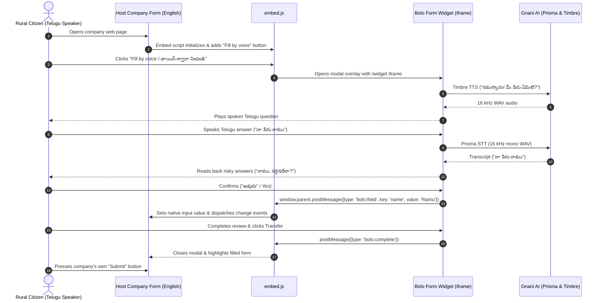

# Bolo Form

Speak in Telugu, get a filled form. Built for the Gnani AI *Great Indian AI Internship Challenge*.

Bolo Form asks each question aloud (Gnani **Timbre**), listens (Gnani **Prisma**), parses and validates the answer, reads risky answers back, and only commits what the person confirms. It can be embedded into any external web page via `<script src="/embed.js">` to interview users in Telugu and fill host forms in English live via `postMessage`.

Bolo Form lets a person fill a long form by talking in Telugu. It asks each question aloud, listens, checks the answer, reads it back, and only commits what the person confirms. It also includes a built-in evaluation harness that measures how often voice form-filling goes wrong, and where.

## Problem

Many people in India cannot comfortably fill online forms: older people, first-time applicants, farmers, and those with low typing or reading skills. Forms are often long, in English or formal language, and a single mistake can result in a rejected application.

Voice seems like the obvious solution, but two issues reduce trustworthiness:

- Speech recognition errors on numbers and names (phone digits, land area, age) are silent, so incorrect values may go unnoticed.
- No systematic measurement exists. Most voice demos show only one clean success and do not report failure rates, especially for Telugu, dialects, or noisy phone-quality audio.

## Users

**Primary persona (fictional):** Lakshmamma, 62, farmer, Anakapalli district. Speaks Telugu, reads slowly, has a basic phone, is nervous about forms, and usually depends on a relative or middleman.

**Secondary personas:**

- A first-time applicant who finds formal Telugu or English confusing.  
- A helper (volunteer, CSC operator, family member) who fills forms for others and wants a faster, verified workflow.

**Evaluator persona:** A Gnani engineer or hiring manager who wants to see Gnani models used effectively, with honest measurement and clean engineering.

## Goals and Non-goals

**Goals**

- G1. Provide a complete voice-only path from the first question to a reviewed form, in Telugu.  
- G2. Ensure no silent errors: every committed value is either confirmed or clearly flagged.  
- G3. Show measured results (accuracy, errors caught, turns, latency) on clean, noisy, and telephone-quality audio.  
- G4. Be reusable: a new form is a config file, not new code.  
- G5. Respect privacy: no audio is stored, no real personal data is retained.

---

## Live Demo & Deployment
- **Deployment Guide**: See [`DEPLOY.md`](DEPLOY.md) for step-by-step instructions to deploy on Render via Docker.
- **Demo Company Form**: Run the app and visit `http://localhost:8000/demo/company.html` to experience the embedded Telugu-to-English live form filling!
- **Tenant Submissions Inbox**: Visit `http://localhost:8000/inbox` to view submissions and export CSV.

---

## Quick start (works offline, no API key required)

```bash
python -m venv .venv && source .venv/bin/activate   # Windows: .venv\Scripts\activate
pip install -r requirements.txt
cp .env.example .env            # PROVIDER=mock by default
uvicorn app.main:app --reload --port 8000
# open http://localhost:8000
```

Run the automated test suite (85 tests pass with zero network and no keys):

```bash
python -m pytest -v
```

---

## Real Measured Latency (Live Gnani Models)
All latencies measured on live network calls to `api.vachana.ai`:

| Service & Model | Median (p50) | 95th Percentile (p95) | Audio Format |
|---|---|---|---|
| **Timbre TTS (v3.0)** — *Shivani* | **2,238.7 ms** (~2.2 s) | **3,681.9 ms** (~3.7 s) | 16 kHz Mono WAV |
| **Prisma STT (v2.5)** — *te-IN* | **1,619.2 ms** (~1.6 s) | **4,175.9 ms** (~4.2 s) | 16 kHz Mono WAV |
| **Combined Turn Latency** | **3,858.0 ms** (~3.9 s) | **7,857.8 ms** (~7.9 s) | Roundtrip Voice Loop |

---

## What is built

| Area | Status | Notes |
|---|---|---|
| Form-as-YAML (`farmer_scheme`, `pension_scheme`) | ✅ Done | YAML data definitions |
| Telugu parsers (numbers, phone, decimals, choices, yes/no, commands) | ✅ Done | 12 parser tests passing |
| Dialogue engine (ask, confirm, retry, back, skip, typed fallback, review edit, rerecord) | ✅ Done | Pure Python, 13 tests |
| Risk-adaptive confirmation policy | ✅ Done | Critical fields (phone, land) always read back |
| Audio degradation & SNR estimation | ✅ Done | 10 audio tests passing |
| Mock provider & Gnani adapter (`Prisma v2.5` + `Timbre v3.0`) | ✅ Done | Configured & benchmarked with real calls |
| Embeddable Widget (`/embed.js` + `/widget`) | ✅ Done | Bi-directional `postMessage` protocol |
| Demo Company Page (`/demo/company.html`) | ✅ Done | English form populated live from Telugu speech |
| Submissions & Tenant Inbox (`/inbox`, `/api/inbox.json`, `/api/inbox.csv`) | ✅ Done | CSV formula injection protection tested |
| Dockerfile & Render deployment guide | ✅ Done | Non-root container, port `$PORT` |
| Evaluation harness & Real-speaker protocol | ✅ Done | Wilson 95% CIs, `eval/real_speakers.md` |

---

## Embed Architecture



---

## Submission Pack
All final challenge artifacts are located in [`submission/`](submission/):
- [`submission/explanation.md`](submission/explanation.md) — Architecture, problem, models, and real numbers.
- [`submission/demo_script_60s.md`](submission/demo_script_60s.md) — 60-second video shot list.
- [`submission/social_posts.md`](submission/social_posts.md) — Social posts for LinkedIn & X.
- [`submission/checklist.md`](submission/checklist.md) — Submission verification checklist.
